# IP2366 140W USB PD Power Display Board

> Currently, an exciting Chinese open-source hardware is available on market places like [AliExpress](https://www.google.com/search?q=aliexpress+140w+1.47&oq=aliexpress+140w+1.47) for well below €10 when you shop wisely: 

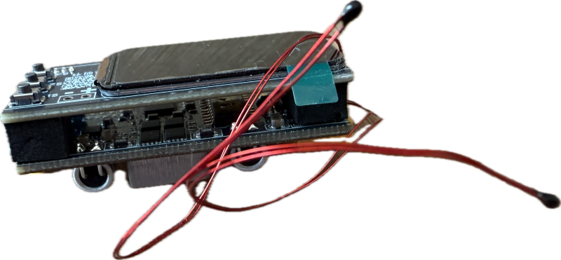

The board is [documented here](https://done.land/components/power/powersupplies/battery/chargers/charge-discharge/ip2366/boards/displayboard/). 

### Let's collect all available information and share experiences
If you come across source code or can share your own experience, please do so here:

- Post an issue or submit a pull request right here in **this repository**.
- Visit the mirror [Github Pages website](https://done.land/components/power/powersupplies/battery/chargers/charge-discharge/ip2366/boards/displayboard/) ([https://done.land](https://done.land/components/power/powersupplies/battery/chargers/charge-discharge/ip2366/boards/displayboard/)), and leave a comment at the bottom of the page you want to add information to.

## Overview

The display version of this board consists of two PCBs: 

- **IP2366 Power Charger and Discharger:**    
  Base board with an [IP2366](https://done.land/components/power/powersupplies/battery/chargers/charge-discharge/ip2366/i2creference/) that has a working I2C Interface [documented here](https://done.land/components/power/powersupplies/battery/chargers/charge-discharge/ip2366/i2creference/) which is available in different hardware versions, with and without a dip switch bank.

    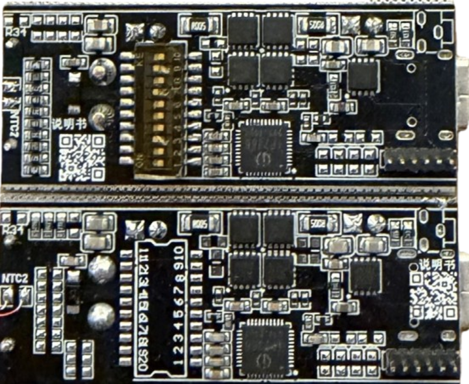

    It features a USB-C and a XT60 connector and connects a battery and a USB PD source/sink.

    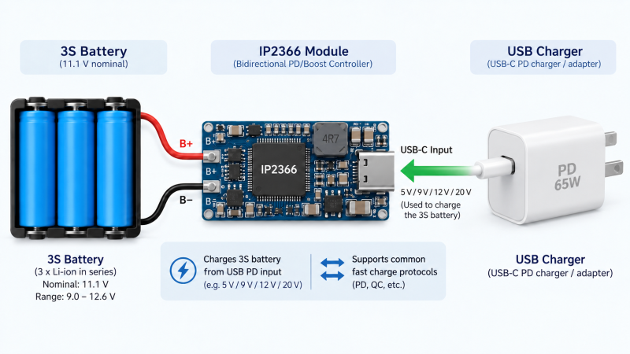

- **Microcontroller + Display (Host Controller):**     
  Display daughter board that piggy-backs and comes with 0.96" and 1.47" displays and a `PUYA` microcontroller. 

    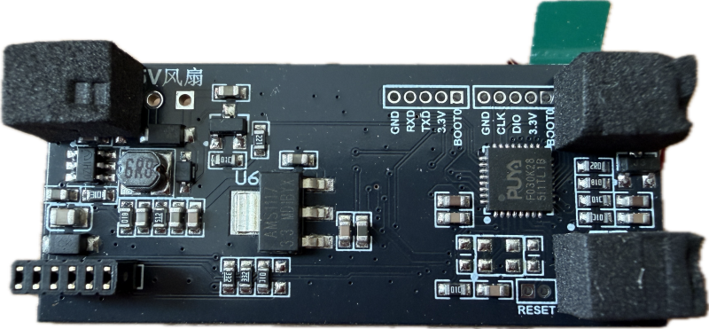

    It exposes its `SWD` interface, and you can [extract and upload new firmware](https://done.land/tools/devices/swddebugprobe/). It also has solder pads to connect a 5 V fan.

    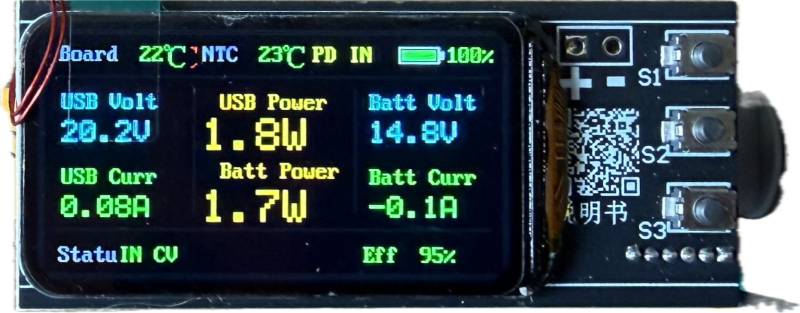

Each PCB comes with one NTC temperature probe, one for the battery, and one for the IP2366.

> [!WARNING]
> Careful about buying the slightly cheaper display-less version: even though the PCB looks almost the same, it comes with a limited IP2366 that does not support `I2C`.

## Cooling

Without additional cooling, the board is limited to around 30 W. With higher loads, the IP2366 goes into frequent thermal shutdown.

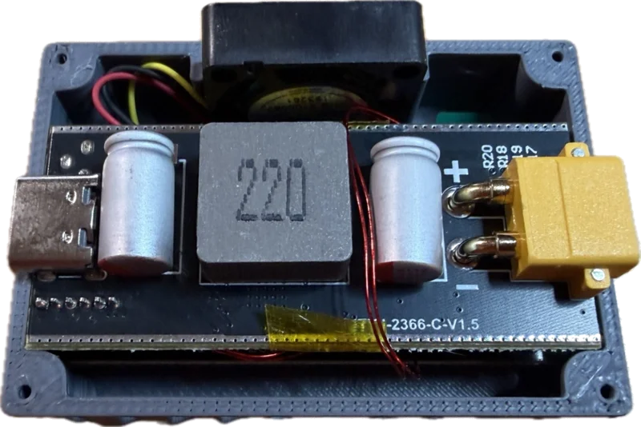

By adding small heat sinks and connecting a fan to the 5 V fan solder pads, you can improve thermal transfer to utilize full 140 W easily:

* small heat sinks and a `2006` fan enabled 60 W continuous
* replacing `2006` by a more powerful `3010` fan enabled 100 W continuous

You may want to [review the IP2366 cooling concepts](https://done.land/components/power/powersupplies/battery/chargers/charge-discharge/ip2366/boards/displayboard/coolingandperformance/) for detailed guidance.

## Housing
There is a [STL file](housing/housing_1.47.stl) available for a 3D printable housing.

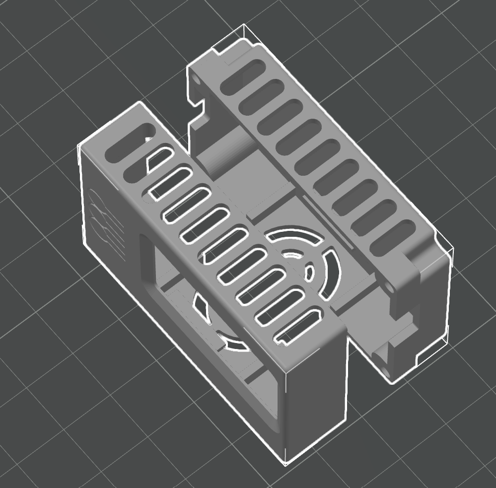

It fits the 1.47" screen and has support for a `2006` 5 V 2- or 3-wire fan.

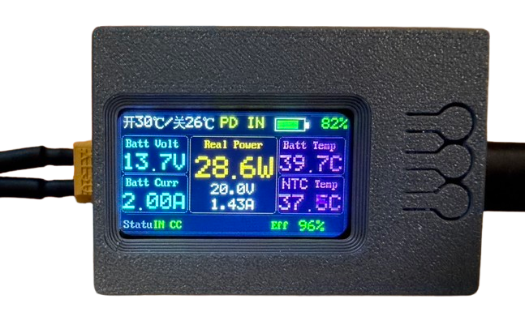

With the `2006` fan and some heat sinks, this small housing is good for up to **60 W** of power.

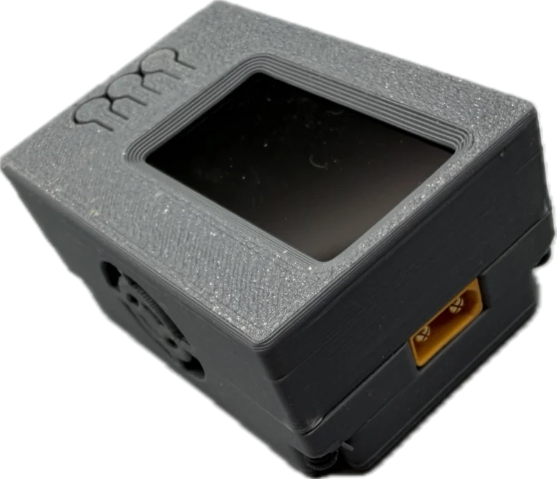

To be able to use the full 140 W, a more powerful fan like `3010` is needed.

## IP2366 with I2C Digital Interface

Buying the display version of this board guarantees that you get a I2C-enabled IP2366 that is accessible through a 6-pin header:

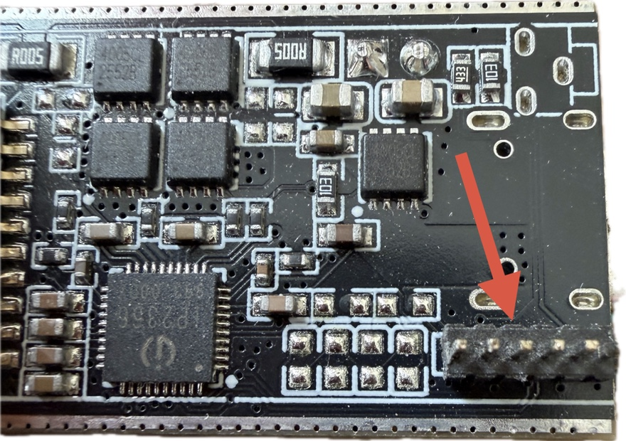

Pin assignment from left to right:

| Pin | Description |
| --- | --- |
| 1 | `GND` |
| 2 | `ENABLE` |
| 3 | `INT`|
| 4 | `SDA` |
| 5 | `SCL`|
| 6 | `BAT+` |

Exercice extreme care when working with these pins. `GND` and `VBAT` pins are the outer pins, and `VBAT` can carry a high voltage with full battery power, so confusing these pins has desastrous effects.

> [!IMPORTANT]
> The base board that comes without a display has no connector and instead four LEDs. The through-holes for the connector are nonetheless present but do not expose I2C as the IP2366 on this board has no I2C capabilities.

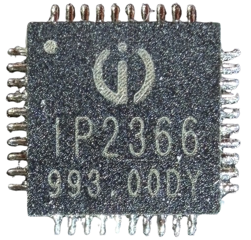

### Replacing Host Controller with ESP32 et al
The modular two-PCB design enables you to strip off the display daughter board with its limited Puya microcontroller, and directly interface with whatever microcontroller you prefer.

I [created a powerful programmable charger](https://done.land/components/power/powersupplies/battery/chargers/charge-discharge/ip2366/boards/displayboard/programmablecharger/) with extensive reporting and web interface by attaching a cheap ESP32-S3 touch tablet to the base board, and [source code is available](https://github.com/TobiasPSP/doneland_sources/tree/main/Components/Power/Power%20Supplies/Battery/Chargers/Charge-Discharge/IP2366/Boards/Display%20Board/Programmable%20Charger/Source%20Code).

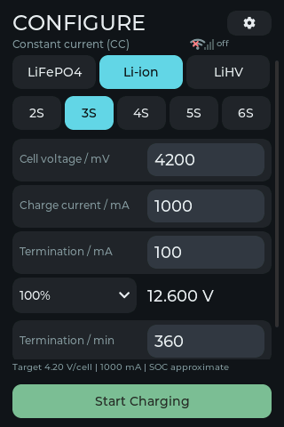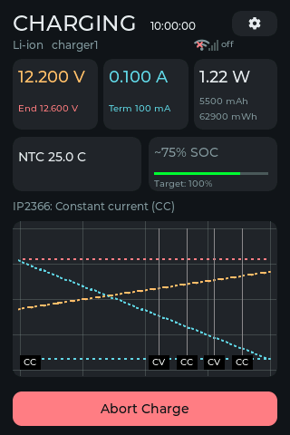

If you want to go this route, here is the complete [IP2366 register map](https://done.land/components/power/powersupplies/battery/chargers/charge-discharge/ip2366/i2creference/).

## Creating Custom Firmware

The display daughter board uses a freely programmable Puya microcontroller and exposes the `SWD` interface, so you can easily [extract the existing binary firmware, and replace it with your own](https://done.land/tools/devices/swddebugprobe/).

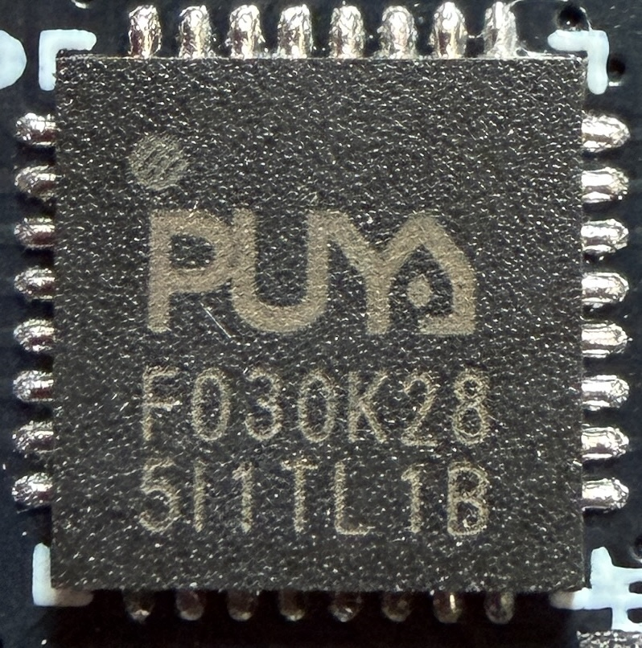

This would enable you to re-purpose the display daughter board for your own ideas, and you would not have to invest into your own microcontroller host as I did in my charger project (see above).

That said, do not get too excited: the Puya has severe memory limitations. There are a lot of cool use cases you could implement on it, however fitting your own ESP32-based host with its web and remote control capabilities to me feels a lot more rewarding.

The most compelling reason to dive into Puya firmware creation is the small footprint that this solution has.

### Source Code

To get started with your own Puya firmware, you do need the original source code, and it is available, however maintained in a **Chinese QQ Group 170681020** which is inaccessible for non-Chinese nationals.

> [!NOTE]
> If you have access to Chinese QQ groups, it would be greatly appreciated if you contacted me (i.e. open an issue or leave a comment [on the bottom of this page](https://done.land/components/power/powersupplies/battery/chargers/charge-discharge/ip2366/boards/displayboard/) so we could get in touch with the original developers and update information in this repository.

Thankfully, one of my Chinese suppliers sent me a copy of the source code for the 1.47" version of this board which apparently is the first-pass port from the earlier 0.98" version. You can find the platformio project files in this repository.

### First Steps
Here is what you would need to do:

1. Identify the `SWD` solder pads on the back of the display board, and attach wires to it

    
    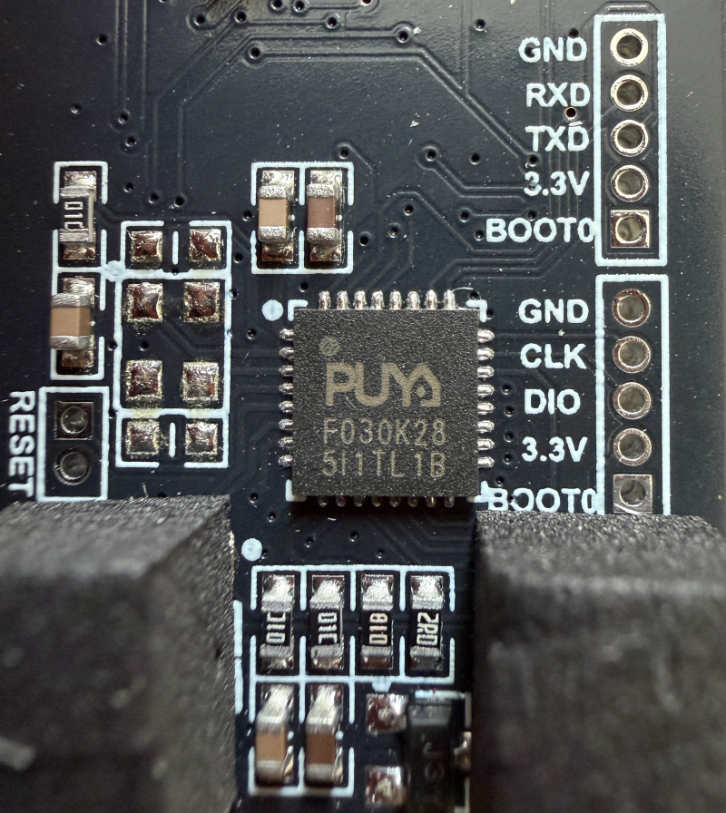

2. Connect a cheap `SWD` debug probe (less than €5 on AliExpress), and [successfully extract and backup your existing firmware](https://done.land/tools/devices/swddebugprobe/) to your PC.
3. Load the [original source code](Firmware%201.47%20inch%20version/README_TFT147_PY32.md) into VSCode/platformio, and start reviewing the source code
4. Team up with AI to adjust/change/revision it the way you want it
5. Compile and create a new binary firmware file, and use the `SWD` interface to upload it

I have not yet had the time to create my own firmware, so I have not yet done step #5 myself. Please share your experience, tips, and potential firmware mods.

